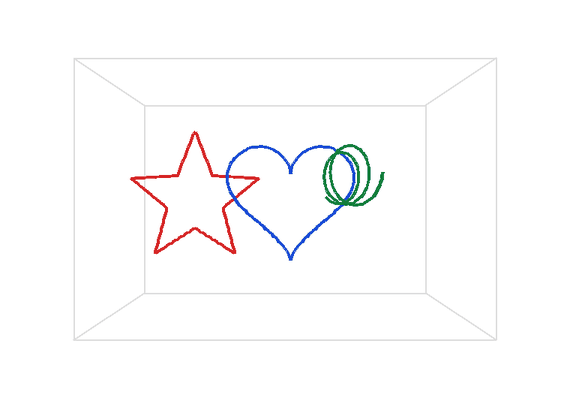

<div align="center">

# ✍️ Air Drawing 3D

**Draw in the air with an ESP32-S3 and a $2 MPU6050, then turn your sketch into a shaded, spinning 3D solid. One key, no extra libraries.**

[](https://github.com/metinakyel21-max/esp32-air-drawing/actions)




<sub>Sketch → press <kbd>E</kbd> → 3D solid. The animation is rendered by the app's own 3D engine (<code>solid_polygons()</code>) from sample strokes.</sub>

</div>

---

## Why this exists

Most "air mouse" demos integrate the gyroscope, so the cursor slowly **drifts into a corner**. This project
steers with **tilt measured against gravity** instead. Gravity is an absolute reference, so the
cursor never drifts: hold the board the way you held it at start-up and the pen goes back to the centre.

Turning a sketch into 3D takes one key: closed shapes (star, heart, circle) become **solid extruded objects**,
open strokes become **ribbons**. Everything is lit and auto-rotates.

## Features

- 🎯 **Drift-free tilt control**: gravity-referenced, works in any mounting orientation (2-second auto-calibration)
- 🧊 **One-key 3D solids**: closed strokes become filled solids, open strokes become ribbons, with flat shading and auto-rotation
- 🧭 **Real 3D canvas**: <kbd>W</kbd>/<kbd>S</kbd> move the pen in depth, drag with the mouse to orbit, perspective lines get thinner with distance
- 🔌 **Finds the right board itself**: scans serial ports and connects only to one that is actually streaming sensor data (a second board without a sensor is ignored)
- 🩹 **Handles loose wires**: firmware detects a dropped I²C bus (all-zero readings) and reconnects. The app throws away garbage samples.
- 💾 **Save and reload**: <kbd>Ctrl</kbd>+<kbd>S</kbd> writes a PNG plus the raw 3D strokes as JSON, <kbd>O</kbd> reopens the last one
- 🪶 **Light**: pure `tkinter` + Pillow + pyserial. No OpenGL, no numpy. Developed on a 3 GB RAM laptop.
- 🌍 **English / Türkçe UI**, picked from your OS locale (`AIR_DRAW_LANG=en|tr` to force)

## Hardware

| Part | Notes |
|---|---|
| ESP32-S3 dev board | tested on ESP32-S3 (CH343 USB-UART). Other ESP32s should work after changing `board` in platformio.ini (untested) |
| MPU6050 (GY-521) breakout | ~$2 |
| 4 jumper wires | **solder the header pins**: loose pins cause dropouts |

### Wiring

| MPU6050 | ESP32-S3 |
|---|---|
| VCC | **3V3** (not 5V) |
| GND | GND |
| SDA | GPIO 8 *(default)* |
| SCL | GPIO 9 *(default)* |
| AD0, INT, XDA, XCL | leave unconnected |

Wires on other pins? Create a `local.ini` next to `platformio.ini` (it is git-ignored):

```ini
[env:esp32s3]
build_flags = -DAIR_SDA_PIN=4 -DAIR_SCL_PIN=5
```

Don't know which pins your wires ended up on? Flash [`tools/i2c_pin_finder`](tools/i2c_pin_finder). It tries every pin pair and prints `FOUND SDA=x SCL=y`.

## Quick start

**1. Flash the firmware** (PlatformIO):

```bash
pio run -t upload
pio device monitor      # you should see  AX:..,AY:..,AZ:..,GX:..,GY:..,GZ:..
```

Arduino IDE users: open `firmware/AirDrawing/AirDrawing.ino` and install *Adafruit MPU6050* (with its dependencies). The header comment lists the board settings.

**2. Run the app:**

```bash
pip install -r app/requirements.txt
python app/air_draw.py              # auto-detects the board
python app/air_draw.py --port COM5  # or pick the port yourself (/dev/ttyACM0 on Linux)
```

**3. Draw:** hold the board still for 2 seconds, tilt to move, <kbd>Space</kbd> to put the pen down, then press <kbd>E</kbd>.

## Controls

| Key | Action |
|---|---|
| <kbd>Space</kbd> | pen down / up |
| tilt the board | move left/right and up/down |
| <kbd>W</kbd> / <kbd>S</kbd> (hold) | move the pen deeper / closer |
| <kbd>E</kbd> | **turn the sketch into a 3D solid** (auto-rotates). Press again to go back. |
| mouse drag / arrow keys | orbit the view · <kbd>R</kbd> resets it |
| <kbd>+</kbd> / <kbd>-</kbd> | more / less sensitive (default: 75° tilt reaches the edge) |
| <kbd>1</kbd>–<kbd>5</kbd> | colour |
| <kbd>C</kbd> | clear |
| <kbd>Ctrl</kbd>+<kbd>S</kbd> / <kbd>O</kbd> | save PNG + JSON / open the last save |
| <kbd>K</kbd> | recalibrate (hold still) |
| <kbd>X</kbd> / <kbd>Y</kbd> / <kbd>D</kbd> | invert horizontal / invert vertical / swap axes |

## How it works

```
MPU6050 ──I²C──▶ ESP32-S3 ──USB serial, 100 Hz──▶ air_draw.py
                  "AX:..,AY:..,AZ:..,GX:..,GY:..,GZ:.."
```

1. **Calibration**: the average gravity vector over ~2 s becomes the neutral direction **n**. Two directions perpendicular to it, **u** and **w**, define "left/right" and "up/down". That is why the sensor can be mounted any way.
2. **Tilt to cursor**: for each sample, the angle of the current gravity vector along **u** and **w** (`asin` of the projection) maps *linearly in degrees* to screen position, smoothed with an exponential filter. Since gravity does not drift, the cursor does not drift either.
3. **3D solid**: each stroke is simplified, then extruded ±`THICKNESS` in depth. Side walls are quads, and closed strokes also get front and back caps. Normals come from Newell's method (robust to duplicate points), faces are flat-shaded and drawn far-to-near (painter's algorithm) on a plain Tk canvas.

### Why not real 3D position?

An MPU6050 measures acceleration and rotation, not position. Integrating acceleration twice to get position builds up error of **metres within seconds**. So depth comes from <kbd>W</kbd>/<kbd>S</kbd>, and "3D" means turning a sketch into a solid. If you want true positional tracking, you need an external reference: camera, UWB, or optical flow. PRs welcome!

## Troubleshooting

| Symptom | Fix |
|---|---|
| `ERROR:MPU6050_NOT_FOUND ... none` | wrong pins or swapped SDA/SCL. Run `tools/i2c_pin_finder`. |
| data stops and starts, `ERROR:MPU6050_READ_FAILED` | loose contact. Solder the MPU6050 header pins. |
| "No ESP32 + MPU6050 board found" | close other serial monitors, check the cable, or pass `--port` |
| cursor moves the wrong way | <kbd>X</kbd>, <kbd>Y</kbd> or <kbd>D</kbd> |
| too fast / too slow | <kbd>-</kbd> / <kbd>+</kbd> |
| SDA wired to GPIO 0 and the board won't boot | GPIO 0 is a strapping pin. Move the wire. |

## Tests

Hardware-free tests cover parsing, tilt math, projection, solid generation and a GUI save/reopen round-trip:

```bash
python -m pytest tests      # or: python tests/test_air_draw.py
```

## Project layout

```
firmware/AirDrawing/AirDrawing.ino   ESP32 firmware (Arduino framework)
tools/i2c_pin_finder/                 finds which GPIOs your SDA/SCL wires are on
app/air_draw.py                       desktop app (tkinter + Pillow + pyserial)
tests/test_air_draw.py                hardware-free tests
platformio.ini                        build config (pins overridable via local.ini)
```

## Ideas / roadmap

- [ ] Export solids as **STL / OBJ** for 3D printing
- [ ] Wireless mode (BLE or Wi-Fi UDP) so the board can be held freely
- [ ] A push button on the board as the pen switch
- [ ] Gyro-based twist for depth (with drift correction)

Contributions are welcome. Open an issue or a PR.

---

<details>
<summary>🇹🇷 Türkçe özet</summary>

**Havada Çizim 3B**: ESP32-S3 ve MPU6050 ile havada çizim yapın, çizimi tek tuşla (<kbd>E</kbd>) dönen 3B cisme çevirin.

- İmleç jiroskopla değil, **yerçekimine göre eğimle** hareket eder, bu yüzden köşeye kaymaz.
- Kapalı şekiller (yıldız, kalp) dolu cisim, açık çizgiler şerit olur.
- Program, sensör verisi gönderen kartı **kendisi bulur**. Sensörsüz başka bir kart takılıysa ona bağlanmaz.
- Arayüz, bilgisayarınızın dili Türkçeyse otomatik Türkçe açılır.

Kurulum: `pio run -t upload` → `pip install -r app/requirements.txt` → `python app/air_draw.py`.
Kablolarınız başka pinlerdeyse `local.ini` ile pin numarasını değiştirin. Hangi pinde olduklarını bilmiyorsanız `tools/i2c_pin_finder` yazılımını yükleyin.

</details>

## License

[MIT](LICENSE). Use it, remix it, ship it.
